# JOBSHEET 9 - ARRAY 1 DIMENSI

**Identitas Mahasiswa:**
* **Nama:** Rediswa Janya
* **NIM:** 264107020243
* **Kelas / No. Presensi:** TI-1D/25

---

## 1: TUJUAN PRAKTIKUM

Berikut adalah tujuan pelaksanaan praktikum pada bab ini:

1. Memahami konsep array 1 dimensi serta cara mendeklarasikan, menginisialisasi, dan mengakses elemennya dalam Java.
2. Menggunakan perulangan `for` dan `foreach` untuk menyimpan, mengolah, dan menampilkan data array.
3. Mengolah data array untuk mendapatkan total, rata-rata, nilai tertinggi, dan nilai terendah.
4. Menerapkan pencarian linear (*linear search*) dan pengurutan *bubble sort*.
5. Menggunakan array untuk menyelesaikan studi kasus pengelolaan nilai mahasiswa dan pemesanan di kafe kampus.

---

## 2: HASIL PERCOBAAN & ANALISIS

### 2.1 Percobaan 1: Deklarasi, Inisialisasi, Mengisi, dan Menampilkan Elemen Array

Percobaan ini membuat array integer berkapasitas empat elemen, mengisinya dengan nilai `5`, `13`, `-7`, dan `17`, lalu menampilkan isinya menggunakan perulangan `for`, `foreach`, dan `Arrays.toString()`.

#### 2.1.1 Kode Program Java

```java
package week12;
import java.util.Arrays;

public class ArrayBilangan25 {
    public static void main(String[] args) {
        int[] bil = {5, 13, -7, 17};

        for (int i = 0; i < bil.length; i++) {
            System.out.println("bil[" + i + "] = " + bil[i] + ", double = " + (bil[i] * 2));
        }

        for (int nilai : bil) {
            System.out.println(nilai);
        }

        System.out.println(Arrays.toString(bil));
    }
}
```

#### 2.1.2 Hasil Running / Screenshot Output

Berikut hasil program yang menampilkan indeks, nilai, hasil perkalian dengan dua, setiap elemen dengan `foreach`, dan seluruh array dengan `Arrays.toString()`.

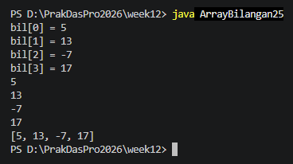

#### 2.1.3 Jawaban Pertanyaan / Pertanyaan Refleksi

* **Pertanyaan 1:** Jika elemen array `bil` diubah menjadi `5.0`, `12867`, `7.5`, dan `2000000`, apa yang terjadi? Mengapa?
  * **Jawab:** Program gagal dikompilasi karena `bil` bertipe `int`, sedangkan `5.0` dan `7.5` bertipe `double` dan tidak dapat dimasukkan ke `int` tanpa konversi eksplisit. Nilai `12867` dan `2000000` adalah bilangan bulat yang masih berada dalam rentang `int`, sehingga keduanya dapat disimpan.
* **Pertanyaan 2:** Bagaimana menginisialisasi array sekaligus saat deklarasi?
  * **Jawab:** Gunakan initializer langsung, misalnya `int[] bil = {5, 13, -7, 17};`. Contoh pada tangkapan layar juga memperlihatkan deklarasi serta penampilan isi array.

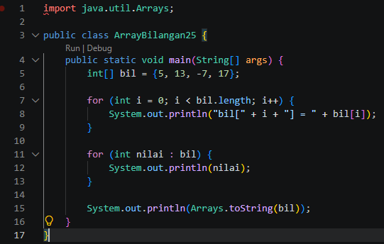

* **Pertanyaan 3:** Apa keluaran dari `System.out.println("bil[" + i + "] = " + bil[i] + ", double = " + (bil[i] * 2));`?
  * **Jawab:** Program mencetak indeks elemen, nilai aslinya, dan nilai elemen tersebut setelah dikalikan dua. Untuk array ini, hasilnya adalah `bil[0] = 5, double = 10`, `bil[1] = 13, double = 26`, `bil[2] = -7, double = -14`, dan `bil[3] = 17, double = 34`.

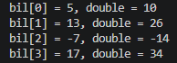

* **Pertanyaan 4:** Apa yang terjadi jika kondisi perulangan diubah menjadi `i <= 4`?
  * **Jawab:** Program akan mengalami `ArrayIndexOutOfBoundsException`. Indeks valid array berkapasitas empat elemen adalah `0` sampai `3`; ketika `i` bernilai `4`, program mencoba mengakses elemen yang tidak ada.
* **Pertanyaan 5:** Apa perbedaan `for`, `foreach`, dan `Arrays.toString()` untuk menampilkan array?
  * **Jawab:**
    * `for` memberi akses ke indeks dan nilai, sehingga sesuai jika indeks diperlukan atau elemen perlu diubah.
    * `foreach` membaca setiap nilai dengan ringkas, tetapi tidak memberikan indeks secara langsung.
    * `Arrays.toString()` mencetak seluruh isi array dalam satu baris, sehingga praktis untuk pemeriksaan cepat.

---

### 2.2 Percobaan 2: Studi Kasus SIAKAD — Input Nilai Mahasiswa dan Status Kelulusan

Program menerima sepuluh nilai mahasiswa. Setiap nilai lebih dari `70` dihitung lulus, sedangkan nilai `70` atau kurang dihitung tidak lulus. Versi program pada berkas praktikum menampilkan jumlah mahasiswa pada kedua kategori.

#### 2.2.1 Kode Program Java

```java
package week12;

import java.util.Scanner;

public class ArrayNilai25 {
    public static void main(String[] args) {
        Scanner input = new Scanner(System.in);
        int[] nilaiAkhir = new int[10];
        int lulus = 0, tidakLulus = 0;

        for (int i = 0; i < nilaiAkhir.length; i++) {
            System.out.print("Masukkan nilai mahasiswa ke-" + (i + 1) + " : ");
            nilaiAkhir[i] = input.nextInt();
        }

        for (int i = 0; i < nilaiAkhir.length; i++) {
            if (nilaiAkhir[i] > 70) {
                lulus++;
            } else {
                tidakLulus++;
            }
        }

        System.out.println("Banyaknya mahasiswa yang lulus: " + lulus);
        System.out.println("Banyaknya mahasiswa yang tidak lulus: " + tidakLulus);

        input.close();
    }
}
```

#### 2.2.2 Hasil Running / Screenshot Output

Gambar berikut menunjukkan contoh keluaran ketika program menampilkan setiap nilai beserta status kelulusannya. Data contoh yang digunakan adalah `85, 60, 72, 90, 45, 78, 66, 95, 50, 71`.

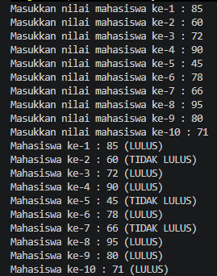

Catatan: tangkapan layar ini menunjukkan versi yang mencetak status setiap mahasiswa. Kode yang disertakan di atas adalah versi yang menghitung jumlah mahasiswa lulus dan tidak lulus.

#### 2.2.3 Jawaban Pertanyaan / Pertanyaan Refleksi

* **Pertanyaan 1:** Apa maksud kondisi `i < nilaiAkhir.length`?
  * **Jawab:** Kondisi tersebut membatasi perulangan agar mengakses indeks dari `0` hingga `nilaiAkhir.length - 1`. Untuk array berukuran 10, indeks yang dibaca adalah `0` sampai `9`.
* **Pertanyaan 2:** Bagaimana agar hanya mahasiswa yang lulus ditampilkan?
  * **Jawab:** Gunakan kondisi `if (nilaiAkhir[i] > 70)` pada perulangan penampilan. Cetak data hanya di dalam blok `if`; nilai yang tidak memenuhi kondisi dilewati.

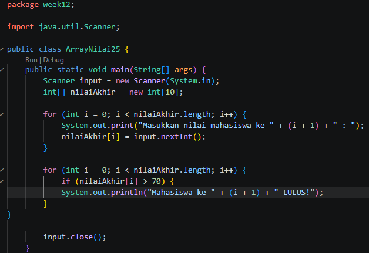

* **Pertanyaan 3:** Apakah seluruh perulangan dapat diganti dengan `foreach`?
  * **Jawab:** Tidak seluruhnya. Pengisian array dari input membutuhkan indeks, sehingga `for` cocok digunakan untuk menyimpan nilai pada `nilaiAkhir[i]`. Perulangan yang hanya membaca atau menampilkan elemen dapat memakai `foreach`.
* **Pertanyaan 4:** Bagaimana menghitung jumlah mahasiswa lulus dan tidak lulus?
  * **Jawab:** Siapkan dua penghitung. Tambahkan penghitung `lulus` jika nilai lebih dari `70`; jika tidak, tambahkan `tidakLulus`. Cetak kedua penghitung setelah seluruh data diperiksa.

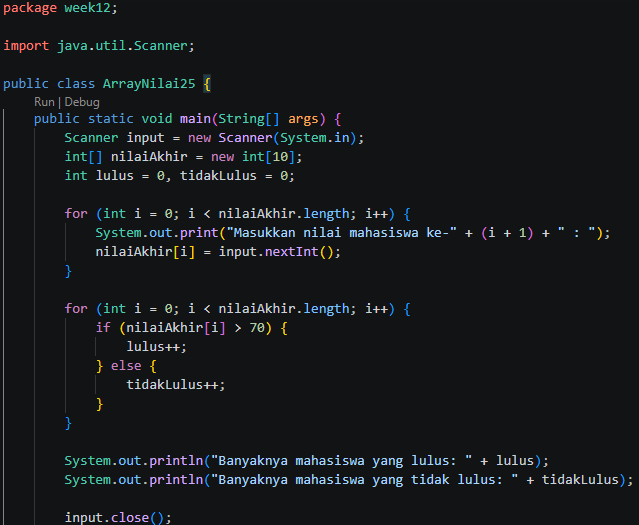

---

### 2.3 Percobaan 3: Operasi Aritmatika pada Array

Percobaan ini menerima jumlah mahasiswa dari pengguna, lalu menyimpan nilai dalam array. Program menghitung total, rata-rata, serta nilai tertinggi dan terendah.

#### 2.3.1 Kode Program Java

```java
package week12;

import java.util.Scanner;

public class ArrayRataNilai25 {
    public static void main(String[] args) {
        Scanner input = new Scanner(System.in);
        System.out.print("Masukkan jumlah mahasiswa: ");
        int n = input.nextInt();
        int[] nilaiMhs = new int[n];
        int total = 0;
        double rata2;

        for (int i = 0; i < nilaiMhs.length; i++) {
            System.out.print("Masukkan nilai mahasiswa ke-" + (i + 1) + " : ");
            nilaiMhs[i] = input.nextInt();
            total += nilaiMhs[i];
        }

        rata2 = (double) total / nilaiMhs.length;

        int tertinggi = nilaiMhs[0];
        int rendah = nilaiMhs[0];
        for (int i = 1; i < nilaiMhs.length; i++) {
            if (nilaiMhs[i] > tertinggi) tertinggi = nilaiMhs[i];
            if (nilaiMhs[i] < rendah) rendah = nilaiMhs[i];
        }

        System.out.println("Total nilai: " + total);
        System.out.println("Rata-rata: " + rata2);
        System.out.println("Nilai tertinggi: " + tertinggi);
        System.out.println("Nilai terendah: " + rendah);

        input.close();
    }
}
```

#### 2.3.2 Hasil Running / Screenshot Output

Contoh berikut menampilkan hasil rekap nilai berupa total, rata-rata, nilai tertinggi, nilai terendah, dan predikat kelas.

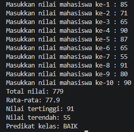

Catatan: tangkapan layar hasil menunjukkan tambahan predikat kelas. Kode yang disertakan di atas mengikuti berkas praktikum dan belum menambahkan predikat tersebut.

#### 2.3.3 Jawaban Pertanyaan / Pertanyaan Refleksi

* **Pertanyaan 1:** Bagaimana menampilkan banyaknya mahasiswa yang lulus (nilai `> 70`)?
  * **Jawab:** Buat variabel penghitung, telusuri array dengan perulangan, dan tambahkan penghitung setiap kali nilai lebih dari `70`.

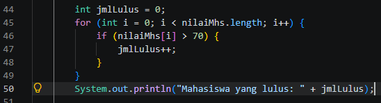

* **Pertanyaan 2:** Bagaimana agar jumlah elemen array tidak selalu 10?
  * **Jawab:** Baca jumlah elemen ke variabel `n`, lalu buat array dengan `int[] nilaiMhs = new int[n];`. Program pada kode di atas menggunakan cara tersebut.

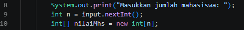

* **Pertanyaan 3:** Mengapa rata-rata dihitung menggunakan `(double) total / nilaiMhs.length`?
  * **Jawab:** `total` dan `nilaiMhs.length` bertipe `int`. Pembagian dua nilai integer menghasilkan pembagian integer yang menghilangkan bagian desimal. Casting `(double)` membuat pembagian menghasilkan nilai desimal sehingga rata-rata lebih akurat.

---

### 2.4 Percobaan 4: Pencarian dan Pengurutan Sederhana

Percobaan ini menggunakan *linear search* untuk mencari sebuah nilai dan *bubble sort* untuk mengurutkan nilai. Kode yang tersedia menjalankan pencarian dengan `key` bernilai `100` dan mengurutkan nilai secara menurun.

#### 2.4.1 Kode Program Java — Linear Search

```java
package week12;

public class SearchNilai25 {
    public static void main(String[] args) {
        int[] nilai = {78, 65, 90, 55, 88, 72};
        int key = 100; // Coba ganti dengan angka yang tidak ada, misal 100
        boolean ditemukan = false;

        for (int i = 0; i < nilai.length; i++) {
            if (nilai[i] == key) {
                System.out.println("Nilai " + key + " ditemukan pada indeks ke-" + i);
                ditemukan = true;
                break;
            }
        }

        if (!ditemukan) {
            System.out.println("Nilai " + key + " tidak ditemukan di dalam array.");
        }
    }
}
```

#### 2.4.2 Kode Program Java — Bubble Sort

```java
package week12;

import java.util.Arrays;

public class SortNilai25 {
    public static void main(String[] args) {
        int[] nilai = {78, 65, 90, 55, 88, 72};

        for (int i = 0; i < nilai.length - 1; i++) {
            for (int j = 0; j < nilai.length - 1 - i; j++) {
                if (nilai[j] < nilai[j + 1]) {
                    int temp = nilai[j];
                    nilai[j] = nilai[j + 1];
                    nilai[j + 1] = temp;
                }
            }
        }

        System.out.println(Arrays.toString(nilai));
    }
}
```

#### 2.4.3 Hasil Running / Screenshot Output

Pencarian dengan `key = 90` menemukan nilai pada indeks ke-2. Jika `key` diganti menjadi `100`, program menampilkan bahwa nilai tidak ditemukan. Hasil pengurutan menurun adalah `[90, 88, 78, 72, 65, 55]`.

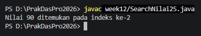

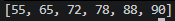

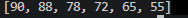

Catatan: gambar pengurutan menaik memperlihatkan tahapan awal percobaan; kode `SortNilai25` yang disertakan di atas mengurutkan secara menurun.

#### 2.4.4 Jawaban Pertanyaan / Pertanyaan Refleksi

* **Pertanyaan 1:** Apa fungsi `break` pada pencarian linear?
  * **Jawab:** `break` menghentikan perulangan segera setelah nilai yang dicari ditemukan. Dengan demikian, program tidak perlu memeriksa elemen berikutnya.
* **Pertanyaan 2:** Bagaimana mengubah program pencarian agar menerima array dan `key` dari pengguna?
  * **Jawab:** Gunakan `Scanner` untuk membaca banyaknya elemen, isi setiap elemen array di dalam perulangan, lalu baca nilai `key`. Lakukan pencarian linear dan cetak indeks jika ditemukan.

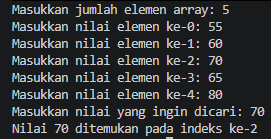

* **Pertanyaan 3:** Bagaimana membuat pesan ketika nilai yang dicari tidak ditemukan lebih informatif?
  * **Jawab:** Gunakan blok `if (!ditemukan)` setelah perulangan untuk mencetak pesan yang menyebut nilai yang dicari, misalnya `Nilai 100 tidak ditemukan di dalam array.`

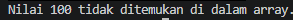

* **Pertanyaan 4:** Bagaimana cara kerja *bubble sort*?
  * **Jawab:** Algoritma membandingkan dua elemen yang bersebelahan. Jika urutannya tidak sesuai dengan arah pengurutan, kedua elemen ditukar menggunakan variabel sementara. Proses ini diulang dalam beberapa putaran sampai seluruh elemen tersusun. Pada pengurutan menaik, nilai terbesar bergerak ke bagian akhir; untuk pengurutan menurun, kondisi pembanding dibalik.
* **Pertanyaan 5:** Bagaimana mengubah pengurutan menjadi menurun?
  * **Jawab:** Tukar elemen jika nilai di sebelah kiri lebih kecil daripada nilai di sebelah kanan (`nilai[j] < nilai[j + 1]`). Kode `SortNilai25` di atas menggunakan kondisi tersebut dan menghasilkan urutan menurun.

---

## 3: TUGAS MANDIRI

Berikut adalah tugas yang dikerjakan pada Jobsheet ini:

- [x] **Tugas 1:** Membuat program pengelolaan nilai mahasiswa.
- [x] **Tugas 2:** Membuat aplikasi pemesanan kafe kampus.

### 3.1 Tugas 1: Pengelolaan Nilai Mahasiswa

Program menerima jumlah dan nilai mahasiswa, menghitung rata-rata, mencari nilai tertinggi dan terendah, serta menampilkan setiap nilai beserta status kelulusannya. Status `LULUS` diberikan untuk nilai lebih dari `70`.

```java
package week12;

import java.util.Scanner;

public class Tugas125 {
    public static void main(String[] args) {
        Scanner input = new Scanner(System.in);

        System.out.print("Masukkan banyaknya nilai mahasiswa yang akan diinput: ");
        int n = input.nextInt();

        int[] nilaiMhs = new int[n];
        int total = 0;
        int tertinggi, terendah;

        for (int i = 0; i < nilaiMhs.length; i++) {
            System.out.print("Masukkan nilai mahasiswa ke-" + (i + 1) + " : ");
            nilaiMhs[i] = input.nextInt();
            total += nilaiMhs[i];
        }

        double rata2 = (double) total / nilaiMhs.length;

        tertinggi = nilaiMhs[0];
        terendah = nilaiMhs[0];
        for (int i = 1; i < nilaiMhs.length; i++) {
            if (nilaiMhs[i] > tertinggi) {
                tertinggi = nilaiMhs[i];
            }
            if (nilaiMhs[i] < terendah) {
                terendah = nilaiMhs[i];
            }
        }

        System.out.println("\n--- HASIL REKAP NILAI MAHASISWA ---");
        System.out.println("Nilai rata-rata : " + rata2);
        System.out.println("Nilai tertinggi : " + tertinggi);
        System.out.println("Nilai terendah  : " + terendah);

        System.out.println("\nDaftar Nilai dan Status Kelulusan:");
        for (int i = 0; i < nilaiMhs.length; i++) {
            String status = (nilaiMhs[i] > 70) ? "LULUS" : "TIDAK LULUS";
            System.out.println("Mahasiswa ke-" + (i + 1) + " : " + nilaiMhs[i] + " (" + status + ")");
        }

        input.close();
    }
}
```

#### Hasil Running

Contoh program dijalankan untuk empat nilai: `66`, `80`, `88`, dan `90`. Rata-rata yang diperoleh adalah `81.0`, nilai tertinggi `90`, dan nilai terendah `66`.

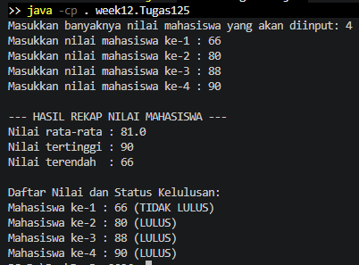

### 3.2 Tugas 2: Aplikasi Pemesanan Kafe Kampus

Program menampilkan daftar menu dan harga, mencari menu menggunakan *linear search*, memvalidasi setiap pesanan, lalu menghitung serta menampilkan total biaya.

```java
package week12;

import java.util.Scanner;

public class Tugas225 {
    public static void main(String[] args) {
        Scanner input = new Scanner(System.in);

        String[] menu = {"Nasi Goreng", "Mie Goreng", "Roti Bakar", "Kentang Goreng", "Teh Tarik", "Cappuccino", "Chocolate Ice"};
        int[] harga = {15000, 13000, 10000, 12000, 8000, 18000, 20000};

        System.out.println("=== MENU KAFE KAMPUS ===");
        for (int i = 0; i < menu.length; i++) {
            System.out.println((i + 1) + ". " + menu[i] + " - Rp " + harga[i]);
        }
        System.out.println("========================");

        System.out.print("\nMasukkan nama makanan/minuman yang ingin dicari: ");
        String cariMenu = input.nextLine();
        boolean ditemukan = false;
        int hargaDitemukan = 0;

        for (int i = 0; i < menu.length; i++) {
            if (menu[i].equalsIgnoreCase(cariMenu)) {
                ditemukan = true;
                hargaDitemukan = harga[i];
                break;
            }
        }

        if (ditemukan) {
            System.out.println("Menu \"" + cariMenu + "\" tersedia dengan harga: Rp " + hargaDitemukan);
        } else {
            System.out.println("Mohon maaf, menu \"" + cariMenu + "\" tidak tersedia di kafe.");
        }

        System.out.print("\nMasukkan jumlah item yang ingin dipesan: ");
        int jumlahPesanan = input.nextInt();
        input.nextLine();

        String[] pesananNama = new String[jumlahPesanan];
        int[] pesananHarga = new int[jumlahPesanan];
        int totalBiaya = 0;

        for (int i = 0; i < jumlahPesanan; i++) {
            while (true) {
                System.out.print("Masukkan nama menu ke-" + (i + 1) + " : ");
                String namaItem = input.nextLine();
                boolean valid = false;
                int hargaItem = 0;

                for (int j = 0; j < menu.length; j++) {
                    if (menu[j].equalsIgnoreCase(namaItem)) {
                        valid = true;
                        hargaItem = harga[j];
                        namaItem = menu[j];
                        break;
                    }
                }

                if (valid) {
                    pesananNama[i] = namaItem;
                    pesananHarga[i] = hargaItem;
                    totalBiaya += hargaItem;
                    break;
                } else {
                    System.out.println("Menu tidak valid atau tidak ada di daftar! Silakan masukkan ulang.");
                }
            }
        }

        System.out.println("\n==================================");
        System.out.println("         DAFTAR PESANAN ANDA      ");
        System.out.println("==================================");
        for (int i = 0; i < pesananNama.length; i++) {
            System.out.println((i + 1) + ". " + pesananNama[i] + " \t- Rp " + pesananHarga[i]);
        }
        System.out.println("----------------------------------");
        System.out.println("Total Biaya : Rp " + totalBiaya);
        System.out.println("==================================");

        input.close();
    }
}
```

#### Hasil Running

Pada contoh, pengguna mencari menu `Kentang Goreng` seharga Rp12.000, kemudian memesan `Teh Tarik`, `Mie Goreng`, dan `Kentang Goreng`. Total biaya pesanan adalah Rp33.000.

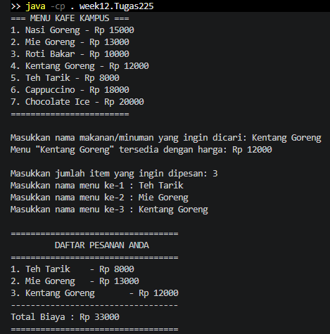

---

## 4: KESIMPULAN

Array 1 dimensi menyimpan sejumlah data dengan tipe yang sama dan mengaksesnya menggunakan indeks yang dimulai dari nol. Perulangan `for` berguna saat indeks diperlukan untuk mengisi atau mengolah elemen, sedangkan `foreach` sesuai untuk membaca elemen secara langsung. Data array dapat diolah untuk menghitung statistik, menentukan status kelulusan, mencari nilai dengan *linear search*, dan mengurutkan data dengan *bubble sort*. Penerapan pada studi kasus SIAKAD dan pemesanan kafe menunjukkan bahwa array membantu mengelola kumpulan data secara terstruktur.
